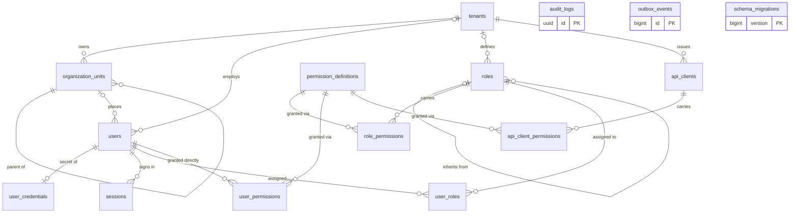
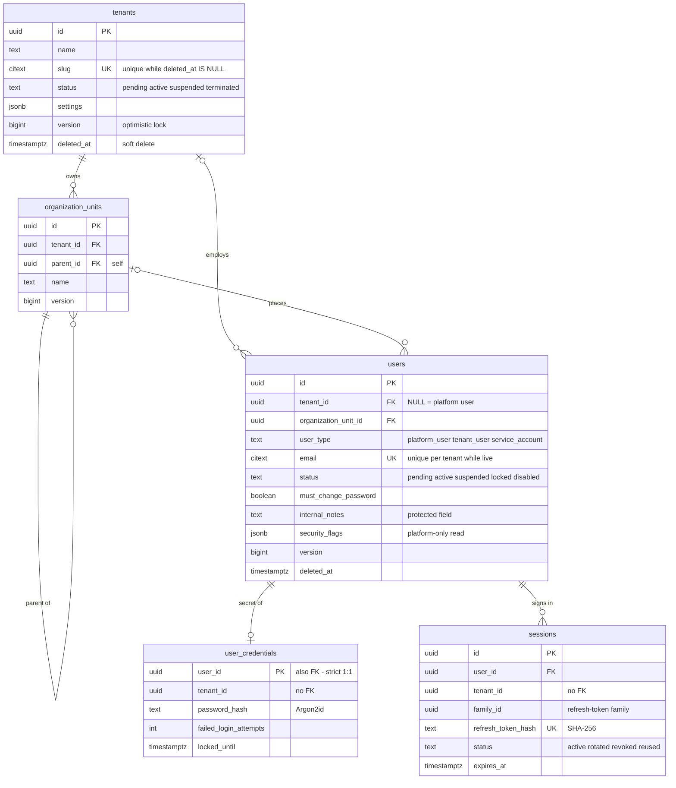
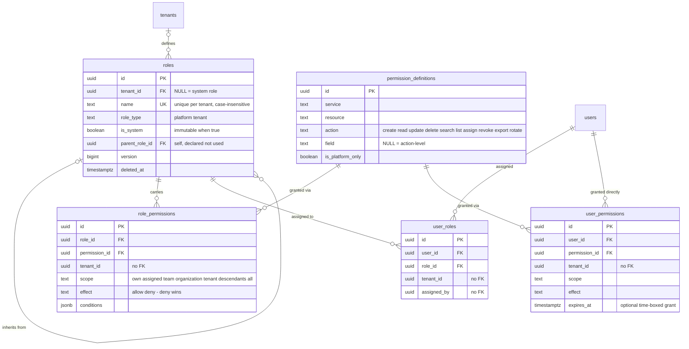
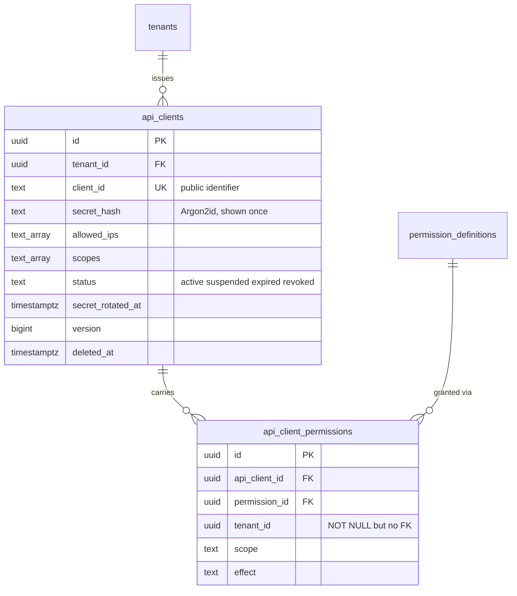
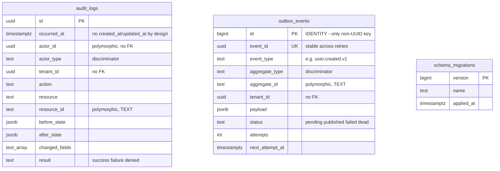

# Database structure — reverse-engineered from the migrations

Reconstructed from `migrations/0001..0009` plus `cmd/migrate/main.go`. Nothing
below is designed or assumed: every table, column, type, key, constraint and
index appears in those files. Where the code implies a relationship the
database does **not** enforce, it is listed separately under
[Inferred relationships](#inferred-relationships-not-enforced) and never drawn
as if it were a foreign key.

No schema or migration was modified to produce this document.

**Companion file:** [`wallet-gateway.dbml`](wallet-gateway.dbml) — paste into
[dbdiagram.io](https://dbdiagram.io/d). Verified with `@dbml/core`: parses to
15 tables, 17 refs, 29 indexes, round-trips to 423 lines of PostgreSQL.

---

## 1. Database inventory

| Database | Engine | Owned by | Schema defined in this repo? |
|---|---|---|---|
| `wallet_gateway` | PostgreSQL 16 | user-management service | **Yes** — `migrations/`, 15 tables |
| `openfga` | PostgreSQL 16 | OpenFGA v1.8.4 | **No** — created by `openfga migrate` (the `openfga-migrate` compose service) |
| Redis 7 | key-value | user-management service | Not relational — no schema |
| Kafka 3.9 | log | user-management service | Not relational — no schema |

### On "a diagram per microservice"

This repository contains **one** service that owns a relational schema.
`cmd/api`, `cmd/worker` and `cmd/migrate` are three binaries built from one Go
module, and all three address the same `wallet_gateway` database — they are not
separate services with separate schemas. So instead of inventing a split that
does not exist, section 3 gives **one diagram per bounded domain** inside that
schema, and section 4 records which binary touches which tables.

The `openfga` database is a genuinely separate database, but its tables are
created and migrated by the OpenFGA binary, not by anything in this repository.
Documenting it from guesswork would be fabrication. To capture it for real:

```bash
docker compose up -d openfga-db openfga-migrate
docker compose exec openfga-db pg_dump -U openfga -d openfga --schema-only
```

---

## 2. Whole schema

15 tables. Only enforced foreign keys are drawn.



`audit_logs`, `outbox_events` and `schema_migrations` have **no** foreign keys
at all. That is deliberate, not an omission — see
[Inferred relationships](#inferred-relationships-not-enforced).

---

## 3. Domain diagrams

### 3.1 Tenancy and identity



### 3.2 Authorization



### 3.3 Machine access



### 3.4 Platform and operations — no foreign keys by design



---

## 4. Which binary touches what

| Table | `cmd/api` | `cmd/worker` | `cmd/migrate` |
|---|---|---|---|
| tenants, users, user_credentials, sessions, organization_units | read/write | — | DDL |
| roles, role_permissions, user_roles, user_permissions | read/write | — | DDL |
| permission_definitions | read only (INSERT/UPDATE/DELETE revoked) | — | DDL + seed |
| api_clients, api_client_permissions | read/write | — | DDL |
| audit_logs | INSERT only | — | DDL |
| outbox_events | INSERT (same transaction as the state change) | SELECT … FOR UPDATE SKIP LOCKED, UPDATE status | DDL |
| schema_migrations | — | — | read/write |

---

## 5. Relationships

### Enforced — all 17 are `REFERENCES` clauses in the DDL

| # | Child → Parent | Cardinality | Null? | On delete |
|---|---|---|---|---|
| 1 | organization_units.tenant_id → tenants.id | many-to-one | NOT NULL | CASCADE |
| 2 | organization_units.parent_id → organization_units.id | many-to-one (self, tree) | nullable | CASCADE |
| 3 | users.tenant_id → tenants.id | many-to-one | nullable | RESTRICT |
| 4 | users.organization_unit_id → organization_units.id | many-to-one | nullable | SET NULL |
| 5 | user_credentials.user_id → users.id | **one-to-one** (FK is the PK) | NOT NULL | CASCADE |
| 6 | sessions.user_id → users.id | many-to-one | NOT NULL | CASCADE |
| 7 | roles.tenant_id → tenants.id | many-to-one | nullable | CASCADE |
| 8 | roles.parent_role_id → roles.id | many-to-one (self) | nullable | SET NULL |
| 9 | role_permissions.role_id → roles.id | many-to-one | NOT NULL | CASCADE |
| 10 | role_permissions.permission_id → permission_definitions.id | many-to-one | NOT NULL | CASCADE |
| 11 | user_roles.user_id → users.id | many-to-one | NOT NULL | CASCADE |
| 12 | user_roles.role_id → roles.id | many-to-one | NOT NULL | CASCADE |
| 13 | user_permissions.user_id → users.id | many-to-one | NOT NULL | CASCADE |
| 14 | user_permissions.permission_id → permission_definitions.id | many-to-one | NOT NULL | CASCADE |
| 15 | api_clients.tenant_id → tenants.id | many-to-one | NOT NULL | CASCADE |
| 16 | api_client_permissions.api_client_id → api_clients.id | many-to-one | NOT NULL | CASCADE |
| 17 | api_client_permissions.permission_id → permission_definitions.id | many-to-one | NOT NULL | CASCADE |

### One-to-one

Exactly one: **users 1—1 user_credentials**. It is a true 1:1 because
`user_credentials.user_id` is simultaneously the primary key and the foreign
key, so a second credential row for the same user is impossible. The schema
permits a user with no credential row, so strictly it is one-to-**zero-or-one**.

### Many-to-many

| Pair | Junction | Pure junction? |
|---|---|---|
| users ↔ roles | `user_roles` | **Yes** — `UNIQUE (user_id, role_id)`, no payload |
| roles ↔ permission_definitions | `role_permissions` | No — carries `scope`, `effect`, `conditions` |
| users ↔ permission_definitions | `user_permissions` | No — plus `expires_at` |
| api_clients ↔ permission_definitions | `api_client_permissions` | No — carries `scope`, `effect`, `conditions` |

The three impure ones are **association tables with attributes**: their unique
key is `(owner, permission, scope, effect)`, so the *same* pair legitimately
appears more than once at different scopes or with opposite effects. Treating
them as a plain M:N link table would lose the permission model.

### Inferred relationships (NOT enforced)

These are implied by the code and column naming. The database does not check
any of them, so a wrong value is possible and nothing will reject it. They are
listed here rather than drawn as foreign keys.

**(a) `tenant_id` denormalized onto child tables — 8 columns.** Copied down so
an RLS policy can filter without a join. The parent is always `tenants.id`.

`user_credentials.tenant_id` · `sessions.tenant_id` ·
`role_permissions.tenant_id` · `user_roles.tenant_id` ·
`user_permissions.tenant_id` · `api_client_permissions.tenant_id` (NOT NULL,
still no FK) · `audit_logs.tenant_id` · `outbox_events.tenant_id`

> Consequence worth knowing: because there is no FK and no trigger keeping these
> in step with the owning row, a row whose `tenant_id` drifts from its parent's
> becomes invisible to that tenant's RLS policy while still existing.

**(b) Actor columns → `users.id` — 14 columns.** `created_by`, `updated_by`,
`assigned_by`, `granted_by` on tenants, organization_units, users, roles,
role_permissions, user_roles, user_permissions, api_clients and
api_client_permissions. Left unconstrained so history survives deleting the
user who made the change.

**(c) Polymorphic — no FK is possible.**

| Column | Points at | Discriminator |
|---|---|---|
| `audit_logs.actor_id` | `users.id` or `api_clients.id` | `actor_type` |
| `audit_logs.resource_id` (TEXT) | any table | `resource` |
| `outbox_events.aggregate_id` (TEXT) | any table | `aggregate_type` |

---

## 6. Constraints

### Unique

| Table | Unique on | Kind |
|---|---|---|
| tenants | `slug` | partial index, `WHERE deleted_at IS NULL` |
| organization_units | `(tenant_id, parent_id, name)` | table constraint |
| users | `(COALESCE(tenant_id, zero-uuid), email)` | partial index — platform users share one namespace |
| user_credentials | `user_id` | primary key |
| sessions | `refresh_token_hash` | index |
| permission_definitions | `(service, resource, action, COALESCE(field, ''))` | index — one NULL-field row per action |
| roles | `(COALESCE(tenant_id, zero-uuid), lower(name))` | partial index, case-insensitive |
| role_permissions | `(role_id, permission_id, scope, effect)` | table constraint |
| user_roles | `(user_id, role_id)` | table constraint |
| user_permissions | `(user_id, permission_id, scope, effect)` | table constraint |
| api_clients | `client_id` | index |
| api_client_permissions | `(api_client_id, permission_id, scope, effect)` | table constraint |
| outbox_events | `event_id` | column constraint |

### Named CHECK constraints

| Name | Table | Rule |
|---|---|---|
| `chk_platform_user_tenant` | users | `platform_user` ⇔ `tenant_id IS NULL` |
| `chk_system_roles_global` | roles | a system role must be global (`tenant_id IS NULL`) |

Every status/type/scope/effect column additionally carries an inline `CHECK …
IN (…)`. They are TEXT with a CHECK, not PostgreSQL `ENUM` types — the DBML
keeps them as `text` and records the allowed values in the column note.

### Triggers

| Trigger | Table(s) | Effect |
|---|---|---|
| `trg_*_updated_at` | tenants, organization_units, users, user_credentials, roles, api_clients | sets `updated_at = now()` before UPDATE |
| `trg_audit_logs_immutable` | audit_logs | raises `audit_logs is append-only` on UPDATE or DELETE |

---

## 7. Indexes

24 explicit indexes beyond the primary keys. Partial indexes carry the
soft-delete predicate so deleted rows cost nothing.

| Index | Table | Columns | Predicate |
|---|---|---|---|
| `ux_tenants_slug` | tenants | slug | `deleted_at IS NULL` |
| `ix_tenants_status` | tenants | status | `deleted_at IS NULL` |
| `ix_org_units_tenant` | organization_units | tenant_id | — |
| `ux_users_tenant_email` | users | COALESCE(tenant_id,…), email | `deleted_at IS NULL` |
| `ix_users_tenant_status` | users | tenant_id, status | `deleted_at IS NULL` |
| `ix_users_tenant_created` | users | tenant_id, created_at DESC, id | `deleted_at IS NULL` |
| `ux_sessions_refresh_hash` | sessions | refresh_token_hash | — |
| `ix_sessions_user` | sessions | user_id, status | — |
| `ix_sessions_family` | sessions | family_id | — |
| `ix_sessions_expiry` | sessions | expires_at | `status = 'active'` |
| `ux_permission_defs` | permission_definitions | service, resource, action, COALESCE(field,'') | — |
| `ux_roles_tenant_name` | roles | COALESCE(tenant_id,…), lower(name) | `deleted_at IS NULL` |
| `ix_roles_tenant` | roles | tenant_id | `deleted_at IS NULL` |
| `ix_role_permissions_role` | role_permissions | role_id | — |
| `ix_user_roles_user` | user_roles | user_id | — |
| `ix_user_roles_role` | user_roles | role_id | — |
| `ix_user_permissions_user` | user_permissions | user_id | — |
| `ux_api_clients_client_id` | api_clients | client_id | — |
| `ix_api_clients_tenant` | api_clients | tenant_id, status | `deleted_at IS NULL` |
| `ix_api_client_permissions_client` | api_client_permissions | api_client_id | — |
| `ix_audit_logs_tenant_time` | audit_logs | tenant_id, occurred_at DESC, id | — |
| `ix_audit_logs_actor` | audit_logs | actor_id, occurred_at DESC | — |
| `ix_audit_logs_resource` | audit_logs | resource, resource_id | — |
| `ix_outbox_pending` | outbox_events | next_attempt_at, id | `status IN ('pending','failed')` |

`ix_users_tenant_created` and `ix_audit_logs_tenant_time` both end in `id`,
which is what makes keyset pagination stable. `ix_outbox_pending` is the index
the worker's `FOR UPDATE SKIP LOCKED` scan rides.

---

## 8. Schema boundaries

One PostgreSQL schema: `public`. The boundaries that matter here are *access*
boundaries, not namespaces.

**Role split.** Migrations run as the table owner. The application connects as
`wallet_app`, which owns nothing — and that is the whole point, because
PostgreSQL does not apply RLS to a table's owner.

**Row-Level Security** is enabled on 12 of 15 tables. Each transaction sets:

```sql
SET LOCAL app.tenant_id   = '<uuid>';  -- tenant principals
SET LOCAL app.is_platform = 'true';    -- platform principals and the worker
```

Neither GUC set ⇒ **no rows are visible**. Deny by default at the storage layer.

| Table | Platform | Tenant |
|---|---|---|
| tenants | all | SELECT + UPDATE own row only |
| users, user_credentials, sessions, organization_units | all | own `tenant_id` |
| roles | all | own `tenant_id`, **plus SELECT on global system roles** |
| role_permissions | all | own `tenant_id`, plus SELECT where `tenant_id IS NULL` |
| user_roles, user_permissions, api_clients, api_client_permissions | all | own `tenant_id` |
| audit_logs | all | SELECT + INSERT own `tenant_id` (UPDATE/DELETE revoked) |
| outbox_events | all | INSERT only |
| **permission_definitions** | — | no RLS: global catalogue, `wallet_app` has SELECT only |
| **schema_migrations** | — | no RLS: touched only by `cmd/migrate` as the owner |

---

## 9. Findings

From `schema_validator.py --strict`, filtered to what actually applies here.
**Nothing was changed** — these are observations.

### Worth acting on: 6 foreign keys with no index

PostgreSQL does not index the child side of a foreign key automatically. Every
one of these is `ON DELETE CASCADE` or `SET NULL`, so deleting a parent forces a
sequential scan of the child table, and the scan happens while the parent row is
locked.

| Table | Unindexed FK | Parent delete triggers |
|---|---|---|
| `users` | organization_unit_id | SET NULL |
| `organization_units` | parent_id | CASCADE (recursive) |
| `roles` | parent_role_id | SET NULL |
| `role_permissions` | permission_id | CASCADE |
| `user_permissions` | permission_id | CASCADE |
| `api_client_permissions` | permission_id | CASCADE |

The three `permission_id` ones also slow the reverse question "who holds this
permission?", which the delegation check asks on every grant.

Low impact today — `permission_definitions` holds 63 rows and is effectively
append-only — but `organization_units.parent_id` is a recursive cascade, and
that one degrades with tree depth.

### Reported but correct as-is

- `audit_logs` has no `created_at`/`updated_at` — it has `occurred_at` and is immutable by trigger.
- `outbox_events`, `user_roles`, `user_permissions`, `api_client_permissions`, `permission_definitions` have no `updated_at` — they are append-only or status-only.
- `permission_definitions` and `user_credentials` have "no index besides the PK" — both are looked up by primary key or by the unique catalogue index.
- `schema_migrations.version` is a sequential BIGINT — correct: it is a migration number, never exposed.

---

## 10. How this was produced

| Step | Command |
|---|---|
| Parse DDL, extract tables and FKs | `python3 scripts/erd_generator.py schema.sql --json` |
| Lint for normalization, indexes, naming | `python3 scripts/schema_validator.py schema.sql --strict` |
| Verify the DBML | `@dbml/core` → 15 tables, 17 refs, 29 indexes, round-trips to PostgreSQL |

`schema.sql` is the concatenation of migrations 0002–0006 plus the
`schema_migrations` DDL from `cmd/migrate/main.go`; 0001 is extensions and
helpers, 0007 is RLS, 0008–0009 are seed data.
