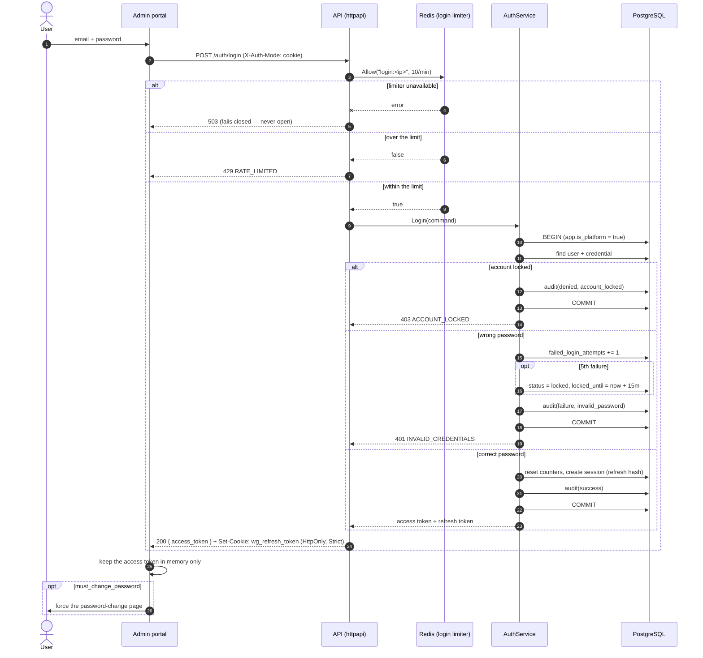
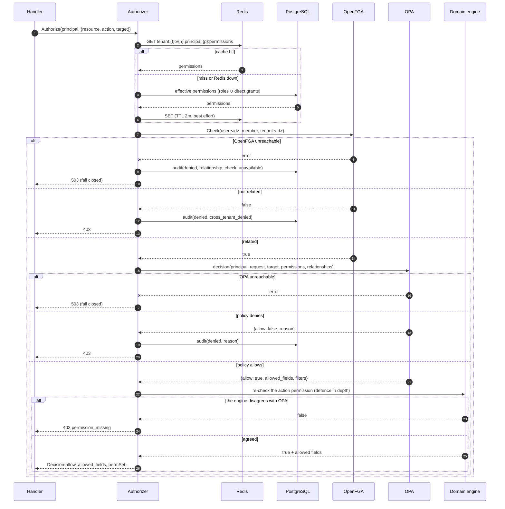
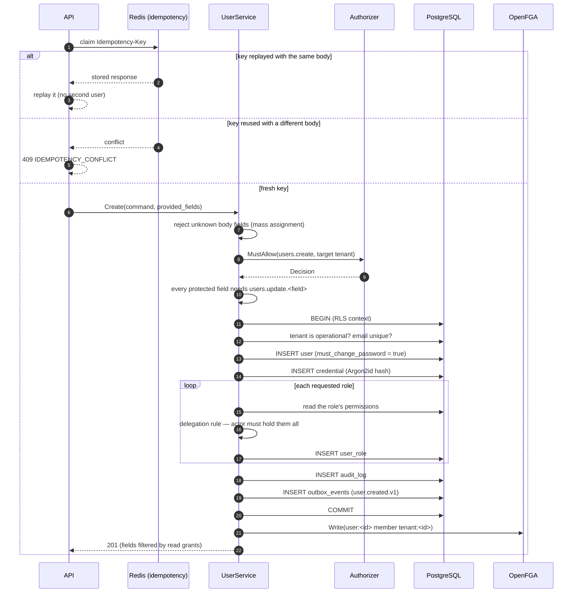
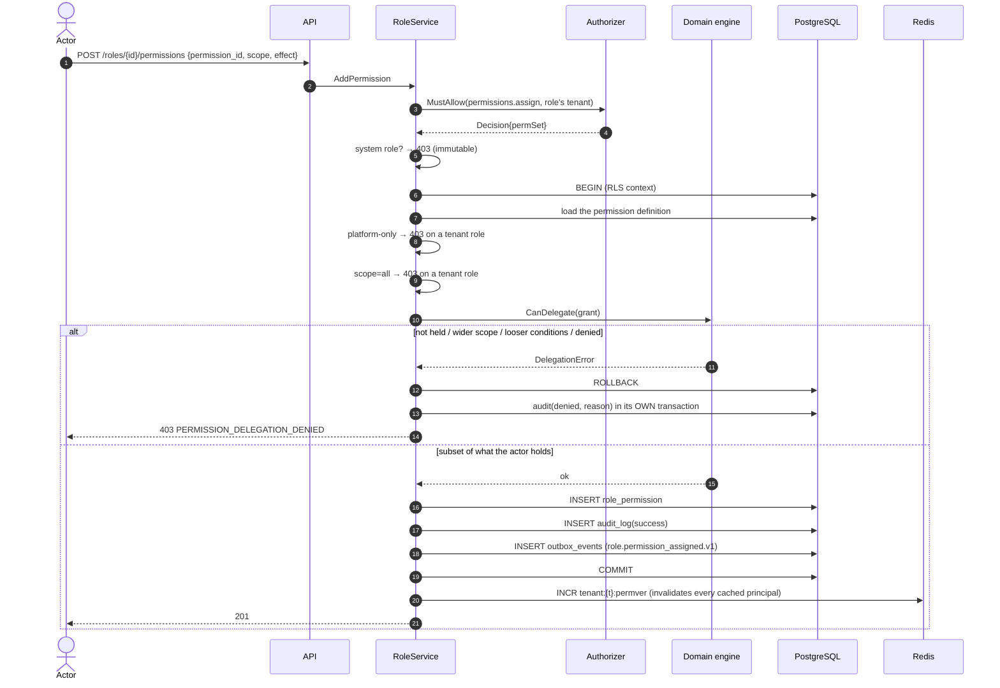
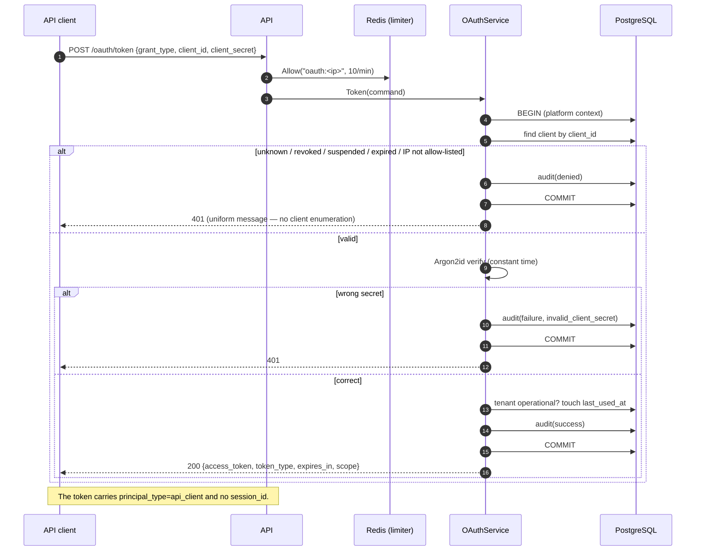
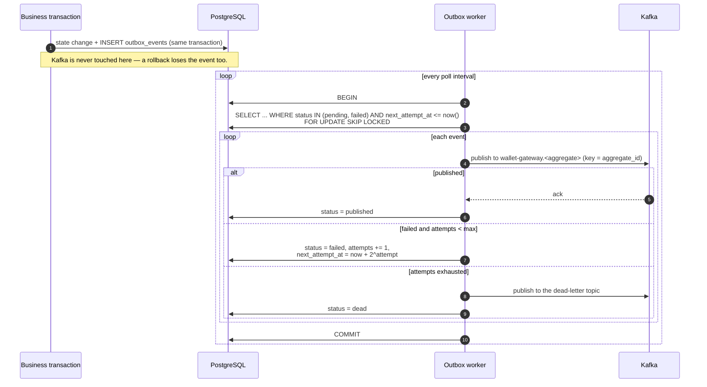
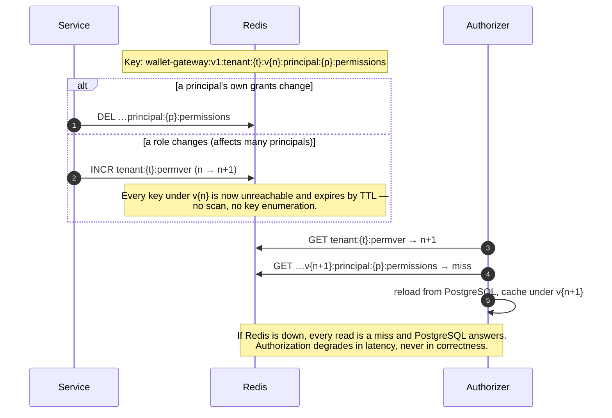

# Sequence diagrams

Every diagram reflects the code as it runs today.

## Login

Note where the transaction commits: a rejected sign-in still persists its
failed-attempt counter, its lock and its audit record. Returning the error from
inside the transaction would roll all three back — see ADR-005.

## Authorization decision

## User creation

## Permission assignment (delegation)

## API client token

## Outbox publish

## Cache invalidation

