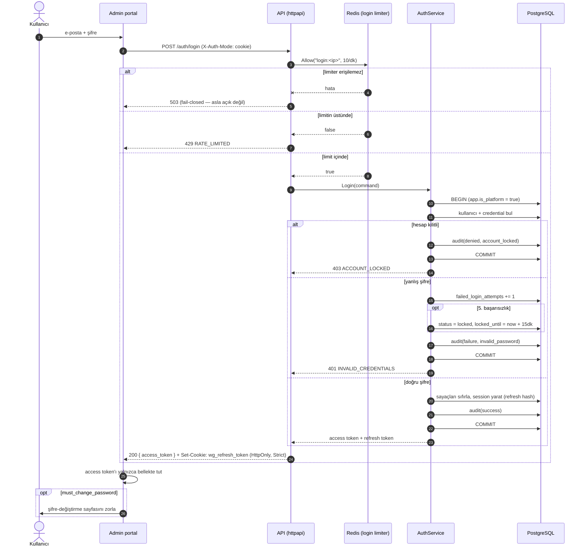
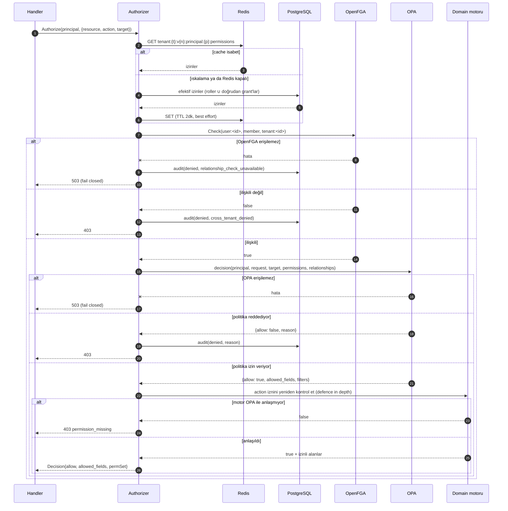
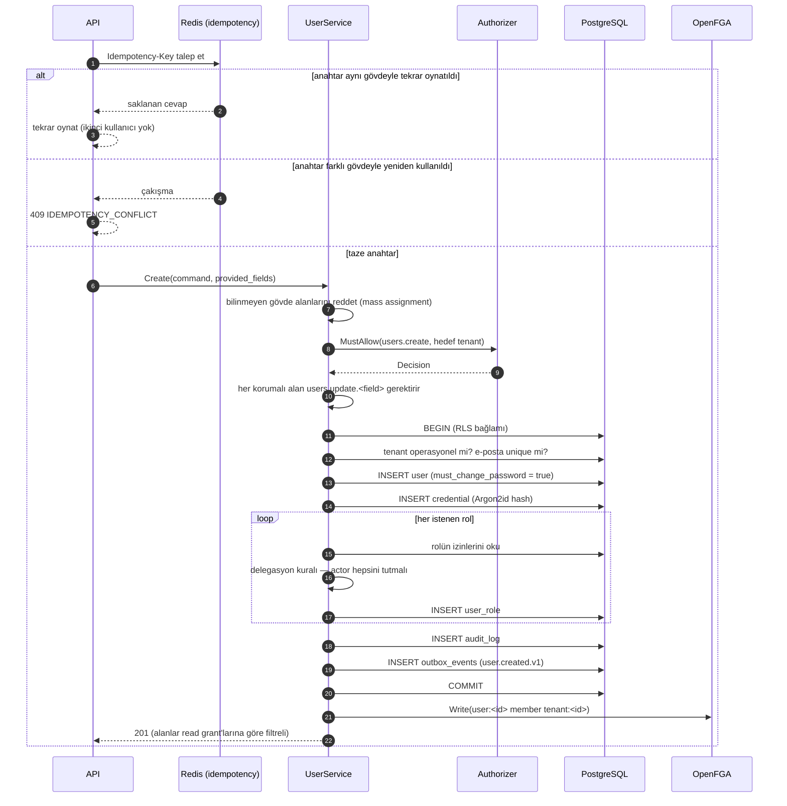
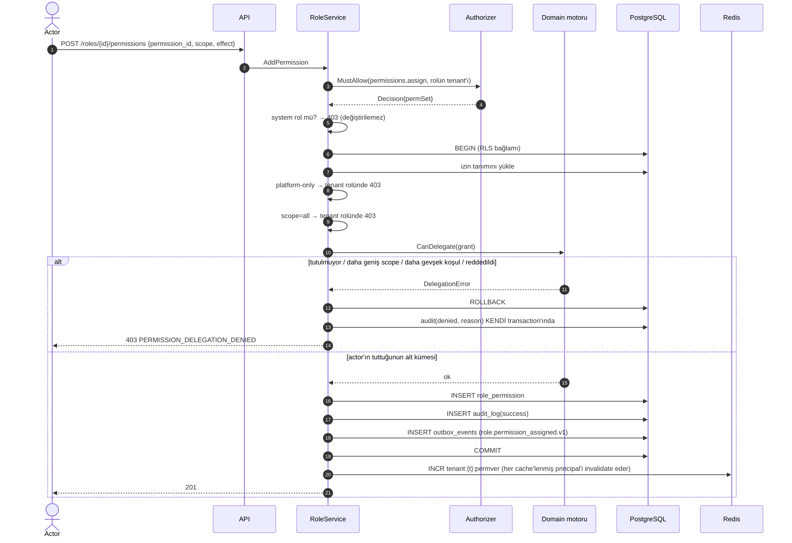
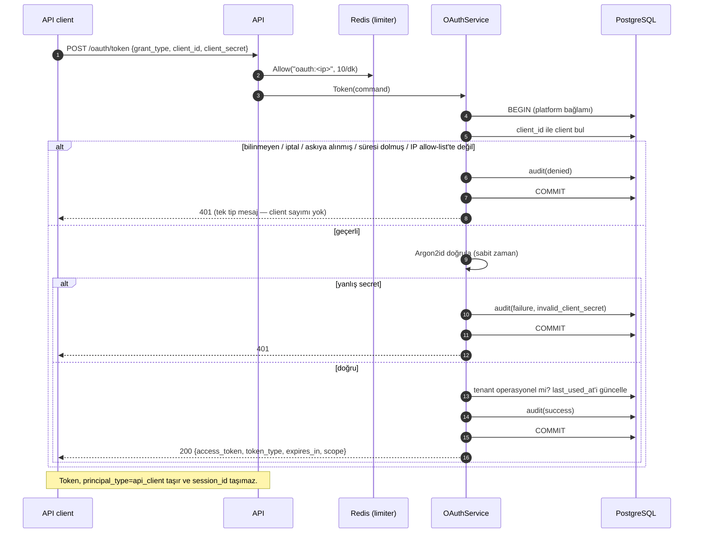
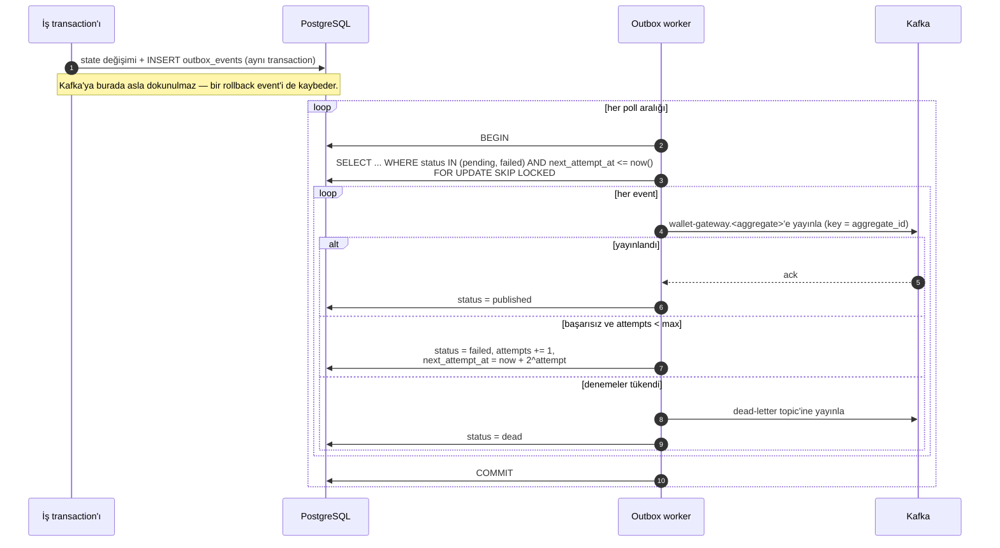
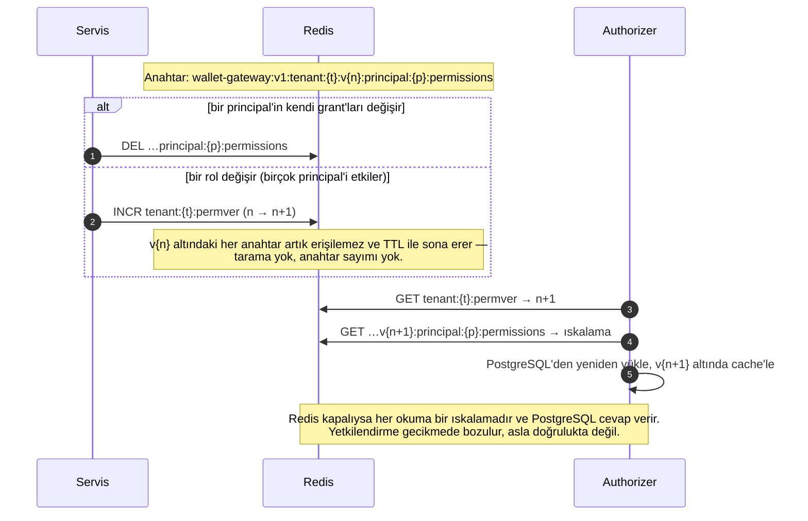

# Sıralama diyagramları

Her diyagram, kodun bugün nasıl çalıştığını yansıtır.

## Giriş (login)

Transaction'ın nerede commit ettiğine dikkat et: reddedilen bir giriş bile
başarısız-deneme sayacını, kilidini ve audit kaydını yine de kalıcı kılar. Hatayı
transaction'ın içinden döndürmek üçünü de geri alırdı — bkz. ADR-005.

## Yetkilendirme kararı

## Kullanıcı oluşturma

## İzin ataması (delegasyon)

## API client token'ı

## Outbox yayını

## Cache invalidation

